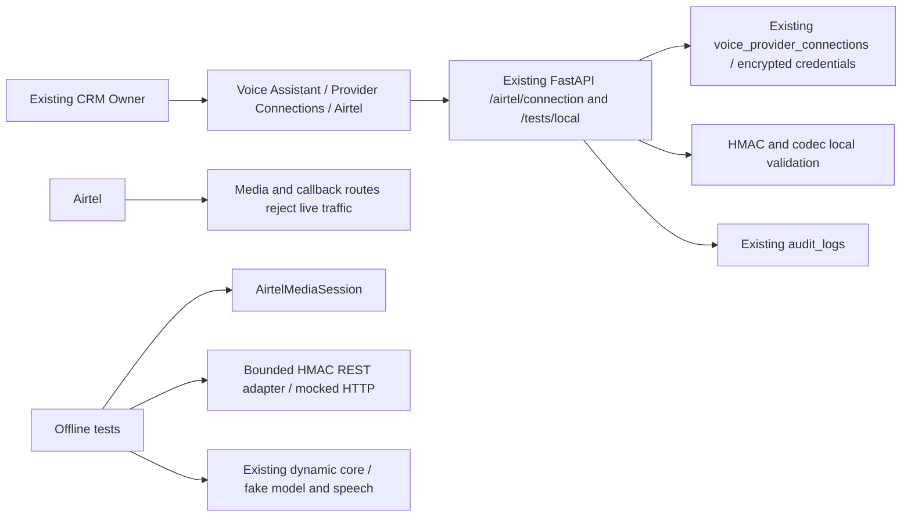

# Airtel IQ VoiceBOT architecture — 15 November 2026

**Implementation stage: configuration and offline wire contracts. Live integration
is blocked, not production ready.** Source of truth: the user-supplied
[22-page guide](reference/airtel_iq_voicebot_integration_guide_v1.0.0_may_2026.pdf).
All pages were read. Existing native PBX, Smartflo, Exotel and Airtel SMS/OTP
implementations are preserved; SMS credentials are not reused for VoiceBOT.

## Implemented boundaries

The registered API prefix defaults to `/api/v1/voice-assistant/airtel`.

| Route | Actual behavior |
|---|---|
| GET `/connection` | Owner-only, returns allowlisted non-secret settings and blockers |
| PUT `/connection` | Owner-only, encrypted write-only credential pair, optimistic version check, invalidates local evidence |
| POST `/tests/local` | Owner-only, decrypt/sign synthetic body and round-trip one synthetic codec frame; no network |
| POST `/webhooks/events` | Always rejects with 403; no ingestion or acknowledgement |
| POST `/webhooks/cdr` | Always rejects with 403; no ingestion or acknowledgement |
| WS `/media` | Rejects before accepting live media, code 1013 |

Generated URLs reflect these registered routes, configured public HTTPS origin and
the actual API prefix. They do **not** prove DNS, TLS, proxy configuration, provider
reachability or authorization. The UI says not to register blocked routes.

## Provider operations from the guide

| Operation | Contract / current implementation |
|---|---|
| Authentication, pp9–10 | Exact-byte SHA256 Digest, RFC1123 X-Date, canonical `x-date`/`digest` HMAC-SHA256 Authorization; implemented, independently fixture-tested |
| C2C, pp10–11 | POST `/gateway/airtel-xchange/v2/adv/ob-click-to-call`; validated primitive and bounded transport implemented, no public call operation wired |
| Recording, p12 | GET `https://openapi.airtel.in/gateway/airtel-xchange/callv2/recording?token=…`; follows curl token placement; bounded binary response, redirects disabled; not imported automatically |
| WSS, pp14–20 | Per-session codec implemented; live authenticated host and installed streaming services missing |
| Call events, p11 | Event names inspected; callback field variants/correlation and bilateral authentication unresolved; ingestion blocked |
| CDR, pp12–13 | Illustrative fields and expected `{"status":"success"}` understood; reducer/authenticated ingestion not implemented |
| SFTP, p13 | Account-agreed layout, credentials, paths and delivery schedule absent; SFTP collector not implemented |

The C2C relative endpoint's origin must be confirmed for the account. The only full
REST origin shown in the supplied examples is the recording origin. C2C is denied
by the primitive unless origin confirmation is explicitly supplied; callback overrides
also require explicit field-variant confirmation. These internal flags are not CRM
live-activation approvals. No REST adapter is exposed to the browser or called by
the local validation action. A 2xx response is transport acceptance, never a claim
of ringing, answer, transfer success or a fabricated provider call ID.

## Stored settings and secrets

`airtel_config.AirtelConnectionInput`: version, public HTTPS origin, write-only App ID
and API key (replace as a pair), remove-credentials flag, account SID, caller ID,
call-flow ID and requested concurrency 1–500 (default target 500). Concurrency is a planning value,
not an admission limit or verified entitlement. Caller/call-flow values are stored
configuration, not verified approvals. Application telephone/metadata limits are
explicit conservative limits, not claimed provider quotas.

Secrets use the CRM's existing server-side encryption, in the existing
`voice_provider_connections` collection under `provider=airtel_iq_voice`, protected
by the existing unique provider index. Responses and audit entries never include
plaintext credentials. App ID/API key are not placed in source, browser storage or
environment variables. The existing CRM encryption key remains a server secret;
rotation/backup operations still follow existing CRM procedures. No new dependency,
environment variable, database collection, worker or infrastructure installation is
required for this offline phase.

Authentication tests are intentionally local: the guide supplies no safe read-only
VoiceBOT auth endpoint. The UI never presents local signing as provider verification.
Native/Smartflo controls and current mock settings retain their original scope.

## Remaining implementation and acceptance phases

1. Agree the account contract: C2C host/response, WSS and callback auth, IP ranges,
   callback fields, stable correlation, incoming routing and human bridge topology.
2. Inventory the actual staging host using existing operator-reviewed inspection
   tooling; choose and install approved compatible speech/model services only after
   measured hardware and authorization. No remote host was inspected in this run.
3. Implement the authenticated media host, trusted call reservations, distributed
   admission/leases, bounded ingress/egress, pacing, conversion/resampling, revocation,
   ownership CAS, crash recovery and provider confirmation. Reuse the existing
   dynamic core and canonical `voice_calls`; do not invent another CRM call history.
4. Implement authenticated correlated event/CDR reduction with idempotency, reorder
   handling and encrypted minimal quarantine; confirm SFTP before implementing its
   collector. Never bind an event to a customer using only a phone number or
   untrusted `customParams`.
5. Reuse scoped recordings/retention and canonical callback Tasks. Provider recordings
   need verified content format and explicit ingestion rules; binary download alone
   does not establish a playable, authorized recording.
6. Run controlled real provider/media/model, fallback and progressive capacity
   acceptance before adding any activation capability. No production deployment
   or paid action was performed.

Simulation actions and mock-worker reconciliation now explicitly filter `provider=mock`,
so future real-provider records cannot be transitioned by simulation code.
