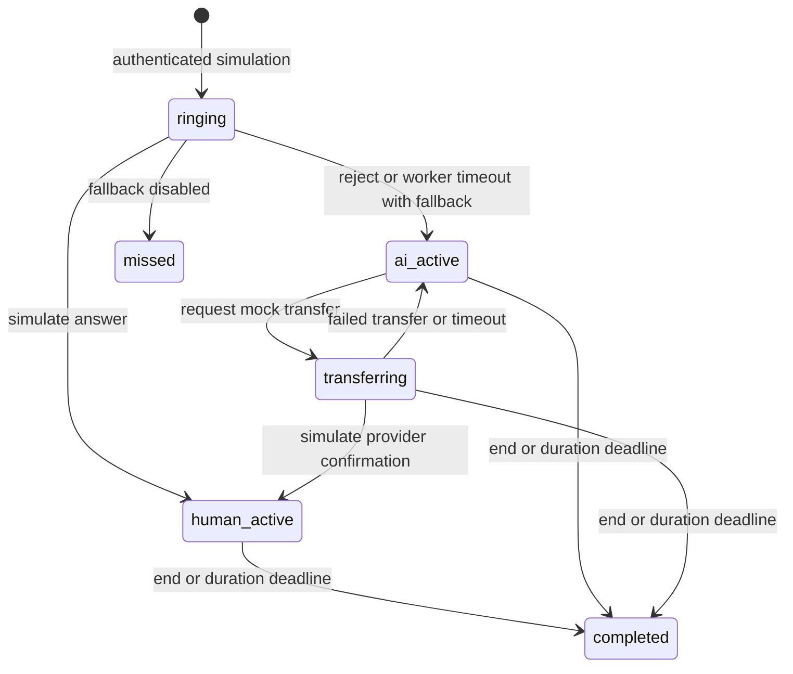

# AI Voice Assistant implementation and operations

Latest continuation evidence, five workstream statuses, test commands, staging
limits and rollback instructions:
[AI_VOICE_ASSISTANT_EXECUTION_REPORT.md](AI_VOICE_ASSISTANT_EXECUTION_REPORT.md).

The advanced-platform audit and new training/artifact batch are tracked in
[AI_VOICE_ASSISTANT_AUDIT.md](AI_VOICE_ASSISTANT_AUDIT.md) and
[AI_VOICE_ASSISTANT_IMPLEMENTATION_PLAN.md](AI_VOICE_ASSISTANT_IMPLEMENTATION_PLAN.md).
Historical foundation results below are retained; live telephony and speech remain blocked.

## Delivery status

The Smartflo upgrade and current verification results are documented in
[SMARTFLO_VOICE_AUDIT.md](SMARTFLO_VOICE_AUDIT.md). Smartflo is now the selected
telephony reference. Provider Connections has real encrypted settings, read-only
diagnostics and quarantined callback observations. Its public audio routes remain
blocked; the Smartflo codec and dynamic audio orchestration are adapter-tested,
not a verified live telephone conversation. Exotel code remains an offline legacy
reference. The historical results and original deployment notes below are retained.

This is a **development foundation**, not the complete production voice assistant in
the master brief. No real calls, recordings, voice uploads, cloned voices, provider
registrations, paid services or production changes were performed.

| Capability | Implemented | Remaining |
| --- | --- | --- |
| Foundation | Layered backend, models, indexes, permissions, capability contracts, disabled default | Verified production adapters, event inbox/outbox and provider reconciliation |
| Dashboard/history | Mongo-backed mock metrics, paginated history, directions/status filters, details/timeline | Full financial/customer filters, exports, outcomes, costs and retention |
| Incoming/handoff | Persistent mock ringing, answer/reject, AI fallback state, transfer request/confirmation/failure | Verified webhook, audio, customer matching, employee notification and availability routing |
| AI conversation | Optional local contextual text model console, prior turns and factual sources | Streaming STT/LLM/TTS or real-time audio, barge-in and audio evaluation |
| Knowledge | Manual articles, chunks, lexical ranking, dates, drafts/review/publication, version checks, 20 retained revisions, rollback to draft | Secure PDF/DOCX/file ingestion, semantic retrieval, evaluation/feedback dashboard |
| Outgoing | Individual mock admission with consent reference, calling window and limits | Durable campaign queues, consent evidence validation, DNC/opt-out enforcement, retries, budgets and real dialing |
| Voice Studio | Accurate unavailable state | Provider voice catalog, samples, consent management, audio validation/scanning/S3 upload and custom voice lifecycle |
| Recording/intelligence | Disabled recording state | Consent notice, recording storage/playback, transcripts, summaries, tasks and deletion/legal holds |
| Resilience | Persistent mock deadlines, optimistic concurrency, duplicate keys, admission lease, worker heartbeat | Live events, uncertain dispatch reconciliation, independently hosted fallback and load/security review |

None of the eight requested phases is represented as entirely complete. In
particular, a simulated `ai_active` call has **no conversation audio**. The dynamic
text console is separate from the call simulator. An unavailable integration has a
readiness explanation rather than a fake functional screen.

## Architecture and changed files

The existing architecture remains React 19/TypeScript with React Query, FastAPI,
Pydantic, Motor/MongoDB, Redis and ARQ. Existing bearer authentication, Owner
restrictions, permission dependencies, API envelope, audit writer, button and page
components are reused. No dependencies were added.

Backend `app/features/voice_assistant/`:

- `schemas.py`: strict inputs, bounded settings, valid timezone/windows and date validation.
- `models.py`: calls, knowledge and allowed state graph.
- `repository.py`: Mongo persistence, compare-and-swap updates and indexes.
- `service.py`: mock lifecycle, quotas, access scope, dashboard and knowledge workflow.
- `router.py`: `/api/v1/voice-assistant` routes with existing permission dependencies.
- `adapters.py`: separate telephony, text conversation and audio contracts; immutable safety policy.
- `conversation.py`: optional local Ollama dynamic text adapter, schema-validated answers and sources.
- `exotel.py`: selected-provider fail-closed adapter and offline media-session codec.
- `catalog.py`: additive permission/navigation catalog seeding, without assigning grants.

`app/main.py` registers the router and initializes indexes, navigation and the
permission catalog automatically at startup. `app/worker/tasks/voice_assistant.py`
and `app/worker/worker_settings.py` add the five-second deadline poll. No outbound
dispatch job is registered.

Frontend `src/features/voice_assistant/` contains `api.ts`, `VoiceAssistantPage.tsx`,
`CallsPanel.tsx`, `KnowledgePanel.tsx`, `SettingsPanel.tsx` and the readiness/permission
UI tests. `src/app/router.tsx` adds `/voice-assistant` and `/voice-assistant/:section`;
`src/components/layout/navConfig.ts` adds the server-filtered sidebar presentation.

`tests/api/test_voice_exotel.py` validates offline Exotel media fixtures, stream identity,
replayed/invalid frames, PCM output, interruption/stop and blocked live operations.
`scripts/voice_catalog.py` applies only this module's additive catalog migration;
`scripts/seed.py` also includes it for fresh installations. `backend/.env.example`
documents optional text-model variables. `tests/api/test_voice_assistant.py` covers
security, lifecycle, limits, recovery, knowledge and model-protocol behavior.

## Persistence and migration

New collections:

| Collection | Data and indexes |
| --- | --- |
| `voice_calls` | Unique idempotency key; owner/created date; status/deadline; call state, mock label, consent reference and timeline |
| `voice_settings` | Unique singleton key; bounded simulator configuration, version and last 20 configuration snapshots |
| `voice_knowledge` | Status/language and unique active content-hash indexes; text/chunks, effective/expiry dates and last 20 revisions |
| `voice_admission` | Mongo `_id` singleton lease, short-lived coordination for mock admission |
| `voice_worker_health` | Unique singleton key and last successful worker sweep |

Calls and knowledge extend the project's `BaseDocument`. New data is additive;
existing records need no transformation. Backend startup now ensures the sidebar
entry and delegatable permission definitions exist, as well as indexes. It never
assigns grants or overwrites an existing inactive navigation entry. The targeted
script below can repair deployments made before this startup registration was
added; do not run the full seed against production just to add this module.

### Missing sidebar after deployment

The sidebar uses the permission-filtered `GET /api/v1/dashboard/nav` response,
not just frontend route definitions. Earlier versions needed the explicit catalog
script; copying/building the code alone did not create the database navigation row.
For an already deployed checkout, run from its `backend` directory:

```bash
.venv/bin/python ../scripts/voice_catalog.py
```

Then reload the CRM (sign out/in or hard refresh) and open `/voice-assistant`.
If the entry is still missing, inspect the authenticated dashboard navigation
response for `voice_assistant`. A missing key indicates the wrong database,
an inactive row or a permission restriction; Owner needs no employee grant.
If the key is present but the sidebar omits it, rebuild the deployed frontend with
`npm run build` and hard-refresh the browser. Verify the deployed source contains
the voice entry in `src/components/layout/navConfig.ts`.

Permissions are `voice_assistant:calls` (`view`, `create`, `edit`) and
`voice_assistant:knowledge` (`view`, `create`, `edit`, `approve`). Owner bypass matches
the CRM engine. Settings and live-gate endpoints remain Owner-only. Employees can
read/control only calls they created, even if they have a module-level View grant.
This deliberately avoids expanding their CRM customer scope. Knowledge View grants
access to this customer-facing knowledge library; do not put restricted customer
records in it. Knowledge is never populated automatically from existing documents.

## APIs

All routes use the existing response envelope and bearer authentication.

| Method | `/api/v1/voice-assistant` suffix | Behavior |
| --- | --- | --- |
| GET | `/dashboard` | Today's scoped mock metrics, active calls, recent activity, heartbeat/readiness |
| GET / PUT | `/settings` | Owner-only bounded settings and optimistic version checks |
| GET | `/providers` | Fail-closed capability/readiness report |
| GET | `/calls` | Page/page_size, direction and status filters; maximum 100 rows |
| GET | `/calls/{id}` | Scoped detail and persisted timeline |
| POST | `/mock/calls` | Idempotent simulated incoming/outgoing call |
| POST | `/mock/calls/{id}/actions` | Versioned mock answer/reject/transfer/confirmation/failure/end |
| GET / POST | `/knowledge` | Paged library / draft creation |
| PUT | `/knowledge/{id}` | Edit, preserve revision and return to draft |
| POST | `/knowledge/{id}/actions` | Review/publish/archive/rollback; Approve permission |
| POST | `/console` | Published-source retrieval, optional dynamic local text generation |
| POST | `/live/{feature}` | Always rejects inbound/outbound/recording/cloning with 403 |

There is no public webhook or media endpoint in this release. Do not configure a
telephone provider to call any mock endpoint. Provider verification, signed media
sessions, durable event idempotency and event ordering must be implemented before
exposing an ingress route.

## Mock lifecycle, timeouts and recovery



Every update checks the stored version and transition graph. Transfer request
records `pending`; only the explicit mock confirmation records success. All such
events are labeled mock and cannot be interpreted as telecom provider evidence.

Ring timeout initially defaults to 10 seconds. ARQ polls every five seconds, so
fallback happens at or after the deadline, subject to worker scheduling latency.
Times are UTC in MongoDB; calling windows/day/month quota boundaries use the
configured IANA timezone. Browser timestamps use the browser's local timezone.
Allowed windows are same-day; overnight calling windows are rejected.

The simulator enforces concurrency, daily calls, calls per minute and reserved
monthly minutes. Incoming simulations are also quota-limited. Outgoing simulations
require a nonempty test consent reference, business hours and no configured holiday.
The reference is **not legally validated consent**, and cannot enable real dialing.
Retries/queue fields are reserved configuration; no retry or queue-dispatch workflow
is implemented, so they are not presented as functioning controls in the UI.

Admission uses a 30-second Mongo lease and unique idempotency key. An expired lease
aborts admission. This is simulator coordination, not a validated production billing
or dispatch reservation algorithm. Production dispatch needs durable atomic quota
reservations, an outbox, provider idempotency, and uncertain-outcome reconciliation.

Worker restarts rescan persisted deadlines without creating new calls. Terminal
states are never reopened. If the worker stops, deadlines stay persisted and its
heartbeat becomes stale; the backend rejects actions after expired deadlines.
Recovery finalizes expired active calls rather than dispatching stale work. This
poller does not answer real telephone calls or keep AI running after server shutdown.
Switching to disabled mode blocks further mock control actions (apart from ending a
session) and finalizes active simulations at the next worker sweep, without waiting
for their previous duration deadline.

## Dynamic text console and knowledge

Manual knowledge is normalized, hashed and chunked, then ranked by lexical overlap
with the current question and recent user context. Only published, current,
language-matching articles participate. Editing/rollback returns content to draft;
publication requires review followed by an authorized approval. Retained content
revisions allow rollback but do not constitute an unlimited revision archive.

Lexical retrieval has a 500-document scan cap and five returned chunks. It is **not
semantic RAG**, and does not guarantee retrieval for paraphrases. A production
embedding/vector index and recall evaluations remain necessary.

By default the console returns `retrieval_only`, no generated response and a clear
warning. Optional local generation uses [Ollama's chat API](https://github.com/ollama/ollama/blob/main/docs/api.md)
and [structured outputs](https://github.com/ollama/ollama/blob/main/docs/capabilities/structured-outputs.mdx).
It sends separate behavior/operational settings, immutable safety instructions,
untrusted factual excerpts and bounded conversation history. The model generates
new contextual responses rather than selecting a predefined Q&A answer.

Environment variables (backend `.env`, no credentials required):

```dotenv
VOICE_LOCAL_AI_ENABLED=false
VOICE_LOCAL_AI_URL=http://127.0.0.1:11434
VOICE_LOCAL_AI_MODEL=
```

To test generation, an administrator must separately provide a running local model,
set its installed model name and explicitly enable the console. Nothing installs,
downloads or launches Ollama. Only loopback HTTP URLs are allowed; redirects and
proxy environment inheritance are disabled. Requests have a 45-second timeout and
bounded output. Invalid output/source identifiers fail to an unavailable response;
model errors do not expose provider payloads. The console reuses Redis rate limiting
at ten requests per minute per client IP. History remains in the browser view
and is cleared with Reset; it is not a persisted transcript.

Prompt rules are defense in depth, **not a proof that model outputs are financially
correct or injection-proof**. The console has no CRM action tools, live media or
customer data access. Responses must be reviewed. Actual natural-language quality,
financial safety and multilingual performance have not been validated against a
running model; protocol tests use an HTTP mock. No speech language is claimed as
supported. Two-letter language values are content metadata, not a speech capability
catalog.

## Provider investigation and activation work

Exotel documents [bidirectional Voicebot WebSocket audio](https://developer.exotel.com/docs/agentstream/websocket-protocol)
and a [Connect Voice AI API](https://developer.exotel.com/docs/agentstream/connect-voice-ai).
These are plausible integration surfaces; account eligibility, commercial access,
India calling purposes, concurrency, signatures, browser calling, interruption
behavior, recording policy and fallback still need account-specific verification.
Exotel was selected by the user; sandbox access still needs setup. A fail-closed
adapter and offline media codec are implemented. The codec checks reserved account,
call and stream identity, negotiated audio format, frame size, sequence order and
PCM payloads. It produces audio, playback markers and buffer-clear messages for
future interruption handling. It is not mounted as a public socket, cannot verify
webhook authenticity, and cannot initiate or control a live call. No Exotel account
connection or sandbox test has been performed.

The documented direct Connect Voice AI path does not provide the multi-step
agent-transfer/compliance flow this CRM requires. Evaluate Exotel's Flow or
Programmable Voice route for the actual employee-first/handoff workflow, rather
than enabling direct Voice AI dialing and assuming transfer works.

[Knowlarity](https://www.knowlarity.com/) is another evaluation candidate. Its precise
streaming, signing and provider-hosted fallback contracts have not been established
for this project, so no capabilities are advertised as enabled.

Next integration work requires confirming the Exotel flow and voice architecture,
then obtaining authorized sandbox access. Keep adapter registration separate from
feature activation, with independent gates for inbound, outbound, recording and
custom voice. Required gates include credential health, provider onboarding,
purpose authorization, reviewed legal/recording policies, documented per-contact
consent, opt-outs/DNC, approved languages/voices and evidence expiry/withdrawal.
Secrets belong in the existing encrypted integration storage or deployment secret
mechanism; never ordinary settings/knowledge fields.

Custom voice work additionally requires actual-format/duration validation,
malware scanning, private S3 storage, voice-owner consent and provider verification,
withdrawal/deletion and production assignment compatibility. Uploading a file must
never automatically create a clone. These workflows are **not implemented yet**.

Server-offline fallback must be hosted independently (provider flow, approved human
forwarding or voicemail). It must be configured/tested with the CRM powered off
before making any availability claim. No such fallback exists in this release.

## Tests and verification

From `backend` on Windows:

```powershell
$env:DEBUG = 'false'
.\.venv\Scripts\python.exe -m pytest -c pyproject.toml ../tests/api/test_voice_assistant.py ../tests/api/test_voice_exotel.py -q
.\.venv\Scripts\python.exe -m ruff check app/features/voice_assistant app/worker/tasks/voice_assistant.py ../tests/api/test_voice_assistant.py ../tests/api/test_voice_exotel.py
.\.venv\Scripts\python.exe -m mypy app/features/voice_assistant app/worker/tasks/voice_assistant.py --follow-imports=silent
```

Use `-c pyproject.toml` because an explicit test path outside `backend` otherwise
does not pick up the configured asyncio mode. This shell had an inherited
`DEBUG=release`; setting a boolean for the test process corrects that environment
without editing deployment files.

From `frontend`: `npm run build`, `npm run lint`, `npm test`.

Recorded results: 21 new backend tests passed; 3 new frontend readiness/permission
tests passed; the existing frontend suite passed 305 tests in 60 files. Frontend
build passed with the bundle-size advisory; lint had zero errors and 10 existing
warnings. Feature-scoped Ruff and strict mypy passed. The full backend regression
run reported **1179 passed, 2 failed, 72 warnings**. Both failures reproduce when
running against the unchanged `HEAD` application entrypoint without this feature:

- `test_advisor_business_owner_employee_and_unauthorized`: the advisor password
  endpoint returns 404 where the existing test expects 403.
- `test_two_applications_same_customer_keep_independent_assignments`: an insurance
  case assignment is `None` where the existing test expects its assigned employee.

These existing modules were left untouched. This is not a fully green regression
suite. Feature/protocol tests do not substitute for provider sandbox testing, real
Mongo concurrency verification or generated-answer quality evaluation. A read-only
probe found no running local Ollama service; no model or service was installed.

## Deployment and rollback

No deployment/migration was executed. The repository AWS PDF uses `/opt/afs-crm`
and `afs-crm-worker`, while the brief names `afs-crm-arq-worker`. Verify the actual
systemd unit rather than installing/renaming anything. From the documented server
checkout, after review and deploying the approved source revision:

```bash
cd /opt/afs-crm/backend
.venv/bin/pip install .
.venv/bin/python ../scripts/voice_catalog.py
cd /opt/afs-crm/frontend
npm ci
npm run build
if systemctl cat afs-crm-arq-worker.service >/dev/null 2>&1; then
  voice_worker_unit=afs-crm-arq-worker
elif systemctl cat afs-crm-worker.service >/dev/null 2>&1; then
  voice_worker_unit=afs-crm-worker
else
  echo 'Existing ARQ service not found; verify the server layout before restarting.'
  exit 1
fi
sudo systemctl restart afs-crm-backend "$voice_worker_unit"
sudo systemctl status afs-crm-backend "$voice_worker_unit" --no-pager
curl --fail http://127.0.0.1:8000/api/v1/health
```

Review indexes/catalog additions and back up Mongo first. No existing data schema
migration or new package is required. Keep local AI off unless separately provisioned
and approved for testing. The module itself starts disabled. Do not overwrite the
server `.env`, modify Nginx, configure provider callbacks or enable real calling.

Rollback: restore the previously deployed source revision, reinstall the backend,
rebuild frontend, and restart the same verified services. Preserve additive voice
collections for investigation; they are ignored by the old application. In a Mongo
admin session for the confirmed CRM database, hide the new navigation with:

```javascript
db.nav_items.updateOne({key: 'voice_assistant'}, {$set: {status: 'inactive'}})
```

Do not delete grants/collections during an incident. Re-enable the existing nav row
explicitly when redeploying after rollback; the additive seeder does not overwrite
an administrator's inactive status.

## Manual checklist and remaining acceptance work

1. Apply targeted catalog/index setup in a development database, then log in as Owner.
2. Open AI Voice Assistant; verify zeros/empty history and all live capabilities disabled.
3. Enable mock mode, simulate incoming call, observe configured timeout with worker running.
4. Verify answer/reject, transfer request pending, explicit confirmation and failure fallback.
5. Restart the worker with expired calls; verify terminal recovery and no duplicate sessions.
6. Verify outgoing mock rejects missing reference, out-of-hours/holiday and exceeded quotas.
7. Create knowledge; verify draft excluded, review/publish included, edit returns to draft,
   expiry excluded and rollback requires renewed publication.
8. Grant employee View only; verify mutation APIs reject and other creators' calls remain private.
9. Optionally configure a local model and manually test paraphrases, contextual follow-ups,
   topic changes, malicious source instructions, uncertainty and human requests.
10. Before production voice acceptance, complete telephony sandbox/audio tests, every claimed
    language/voice test, consent/opt-out/campaign/recording/retention tests, provider outage
    reconciliation, server-offline fallback, and load/security/regression reviews.

The production acceptance criteria and the mandatory real-time dynamic **voice**
conversation test are outstanding. The implemented text-model integration is a
starting point for that work, not evidence that telephone conversations work.
