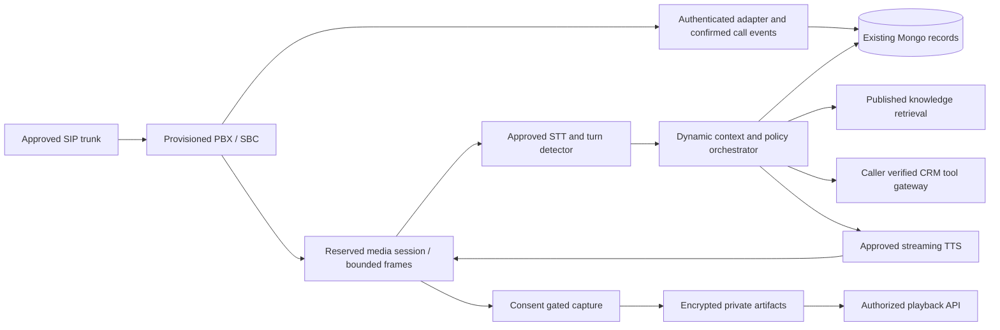

# Voice platform architecture

The CRM remains React/React Query -> FastAPI -> Mongo, with Redis/ARQ workers.
Call control, media transport, conversation orchestration, retrieval, authoritative
CRM tools and recording storage are separate boundaries. Smartflo is optional;
provider-specific envelopes belong in its adapter. The web app is not a SIP server.

Arrows describe the target, not verified installed live services. Among AI/media
integrations, optional local text inference and offline media protocols have code. No approved
STT/TTS engine is selected or enabled. Sensitive tool calls remain blocked until
caller verification and resource access policy exist. Audio encoding contracts
declare their format; `AudioFormat` supports bounded mu-law and PCM16 framing.
Smartflo uses mu-law 8 kHz, other transports must negotiate
and normalize explicitly. Never call a PCM-only service with mu-law bytes.

## Self-hosted telecom evaluation

Asterisk ARI exposes documented external-media integration (RTP/AudioSocket and,
on compatible versions, media WebSocket). It is a strong candidate for a separate
Linux PBX that hands channels to a Stasis application; the CRM should consume
authenticated control and media interfaces, not recreate SIP/RTP. See official
[external media](https://docs.asterisk.org/Development/Reference-Information/Asterisk-Framework-and-API-Examples/External-Media-and-ARI/),
[WebSocket driver](https://docs.asterisk.org/Configuration/Channel-Drivers/WebSocket/),
and [license](https://github.com/asterisk/asterisk/blob/master/LICENSE).
No ARI endpoint is activated by this implementation. Version compatibility,
licensing/distribution, codecs, SBC/NAT, SRTP/TLS, trunk provisioning, concurrency,
recording semantics, agent devices and emergency failover require review/testing.

FreeSWITCH is an alternative with SIP/media and ESL control; see its
[official manual](https://developer.signalwire.com/freeswitch/). Operational skill,
build/package availability, security patching and license/module compatibility
must be evaluated against the chosen server. Neither engine is installed in the
existing Compose deployment. Asterisk is a candidate, not an approved choice.

## Knowledge and artifacts

Draft document extraction cannot change publication. Existing articles hold
draft content and an optional immutable approved publication snapshot; retrieval
uses the approved snapshot while a revision is evaluated. Explicit archiving
removes it from retrieval. Publication and rollback are version checked and
audited. Deterministic retrieval evaluation does not certify LLM groundedness.

Imported WAV artifacts are separate from blocked live capture. Mongo holds only
metadata; encrypted bytes live in an explicitly configured private filesystem,
outside static/frontend directories. Each artifact links to an authorized call.
The storage layer verifies ciphertext/decrypted integrity before returning audio.
Imported transcripts use a bounded encrypted derivative field in the recording
document so transcript replacement and parent version/status update are atomic.
They are operator-supplied recognition, not independently verified STT output.
Production durability requires persistent volumes, permissions, key management
and tested backups; a writable directory alone is not operational verification.

## Extending adapters

Implement capability contracts and bounded timeouts, keep credentials server-side,
authenticate events/reserved media sessions, reconcile real control outcomes and
test in approved sandbox. Capability flags must be backed by evidence. New adapters
must not turn mocked speech, accepted HTTP requests or saved credentials into live
success. No provider-specific secret is required for offline training or artifacts.
