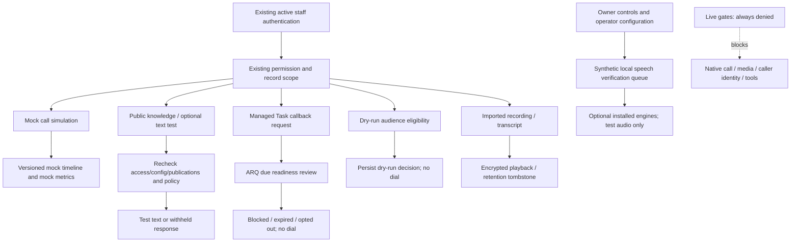
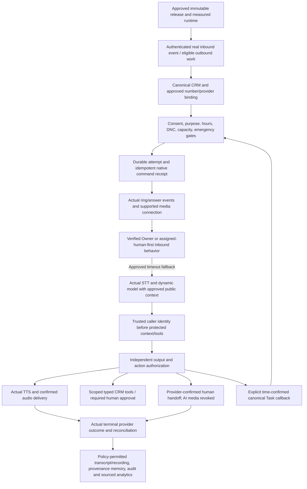

> **Implementation update ? 17 October 2026: NOT COMPLETE / NOT PRODUCTION READY.**
> The canonical managed Task now supports terminal closed_ineligible recovery for lost parent/principal/customer eligibility, continuing suppression review for expired confirmations, and an Owner-only cancel resolution from Tasks without reviving deleted-parent access. Task history carries durable audit receipt identities for replay/worker repair. Historical service_callback grants are not converted; new callback consent uses exact callback. Offline stream requires host authorization and shared policy before synthesis/delivery, while real live paths remain disabled.
> See [current implementation, traceability and execution evidence](VOICE_HARDENING_EXECUTION_2026_10_17.md) and [self-hosted staging contract](VOICE_SELF_HOSTED_STAGING_CONTRACT.md).
> The original audit below is retained verbatim as historical baseline evidence; its statements about unchanged source, findings, test counts and pending implementation approval describe that earlier audit, not this worktree.

> Final local verification: **1,408 backend passed / 1 Linux-only skip; 354 frontend passed; build passed**. These are local/mock/synthetic results, not PBX, installed-model or staging acceptance. See the execution report for commands, warnings, earlier failures and remaining gates.

---

# AI Voice Assistant — canonical workflow

17 October 2026. **Current behavior and recommended target are deliberately separate.**
This document changes no states, records, routes or business rules. See the
[as-built source map](AI_VOICE_ASSISTANT_COMPLETE_AS_BUILT.md) and
[findings G01–G17](AI_VOICE_ASSISTANT_GAP_ANALYSIS.md). V/U/W are the directories
defined in that source map. Single-company architecture/Owner semantics remain
those of decision 001 and the existing PermissionEngine.

## 1. Current source-of-truth and authorization boundaries

| Boundary | Authoritative current component | Preconditions / postconditions |
|---|---|---|
| Staff identity | auth.dependencies / require_permission / employee.require_owner | Valid CRM Bearer subject, active user; Owner bypass or actual employee grants. No telephone identity is created |
| Lead | LeadService.get_lead_scoped | Owner or assigned employee / permitted own unassigned draft; callback additionally checks module action |
| Loan | LoanCaseService.get_case | Actual workflow/case type and existing application/case assignment rules; callback checks current stage action |
| Insurance | InsuranceCaseService.get_case/_employee_can_see | Actual creator/linked Application employee assignment; Advisor case assignment is not staff authorization |
| Customer | CustomerService.get_customer_for_staff | Existing customer record/assignment; phone matching is linkage, not proof of caller identity |
| Simulated call | VoiceService.call/scope + voice_calls | Creator or Owner; version/state/deadline guards; provider remains mock |
| Public evidence | VoiceService.retrieve + voice_knowledge publication | Matching language/date and approved current publication, bounded lexical ranking; no protected CRM context |
| Callback | CallbackService + existing tasks | Entity and Task/voice permissions plus assignee; one canonical request/history, no second scheduler |
| Contact eligibility | CampaignService policy methods + callback due checks | Owner attestations, separate purpose-specific grant and suppression; existing SMS preference is insufficient |
| Artifact | RecordingService.get/audio/transcript + private storage | Owning-call scope, recording permission, unexpired completed state, integrity; download adds permission |
| Live activation | PlatformService.activation/require_live, NativeVoiceService.number_action, VoiceService.require_live | Always denied; no DB/client flag can create a positive live path |

API-level RBAC does not make every lower-level service an independent tool API.
Future AI calls into these services require a trusted server session and explicit
authorization, not the model's actor/customer identifiers.

## 2. Current implemented workflows

These paths share CRM identity/permissions, history/audit helpers and the existing
ARQ worker; they do not currently form a live end-to-end telephone conversation.

### 2.1 Configuration and preflight

1. Owner opens Settings/Provider Connections. API can insert disabled default
   environment control records on first platform status request.
2. Optional server configuration defines cached local-model origin/model, speech
   profiles, native origin allowlist and private recording directory. No assets
   install/download themselves.
3. Connection save encrypts write-only credentials. Native tests only read ARI;
   Smartflo only reads Users scope. No saved number/reference is telecom approval.
4. Component enablement permits local tests, not production. Unsupported media,
   recording and transfer runtime enablement is denied. Changing components resets
   live directions/stop and invalidates evidence through versioning.
5. Owner may request bounded local model/speech tests. Their evidence expires or
   becomes invalid when current config/schema/policy changes.
6. Every current live enable/number activation/live-entry request fails closed.

Failure paths: invalid URL/profile/number is rejected; absent credentials/allowlist
prevents network tests; credential rotation clears current proof; stale version
conflicts require refresh. No test result bypasses approval or hard live denial.
Environment configuration reload requires coordinated API/worker restart through
the existing deployment process; database control changes are read at runtime.

### 2.2 Simulated inbound and outbound calls

Entry is POST `/voice-assistant/mock/calls`, not a carrier webhook. Incoming accepts
a test label; outgoing additionally checks consent-reference presence and current
hours/holidays. Admission uses its existing lease, counts and budgets. It stores
`ringing` with creator/assigned-employee metadata and deadline; no phone is dialed.

| Current state | Permitted next states in models.TRANSITIONS |
|---|---|
| queued | ringing, cancelled, failed |
| ringing | human_active, ai_active, missed, completed, failed |
| ai_active | transferring, completed, failed |
| human_active | completed, failed |
| transferring | human_active, ai_active, completed, failed |
| completed / missed / failed / cancelled | None |

Creation currently starts in `ringing`; declared queue/failure transitions do not
imply an implemented queue/dial failure source. There is no separate answered or
initiating status; answered_at is set when entering a human/AI active state.

`VoiceService.act` requires current call ownership, version, state and deadline.
Answer simulates human_active; reject/timeouts may select ai_active. Transfer is
accepted only from ai_active. UI confirmation is explicitly mock provider confirmation;
failure/timeout returns to AI or completes according to settings. End completes.
`sweep` catches expired sessions and appends a versioned transition; terminal
duration derives from stored answered time. Switching mock mode off reconciles
existing simulations; it does not drain real media.

Idempotency: unique key and payload comparison, ownership check on replay. CAS
rejects duplicate/stale control changes. Postconditions: simulated timeline/audit
and metrics only; no verified employee phone ring or Owner-specific notification.

### 2.3 Dynamic text and local utterance processing

1. Console input accepts bounded question/history with user/assistant roles only.
2. English priority contact/human signal returns safety_hold immediately; action
   remains a proposal. Existing Owner contact-policy UI must perform any real DNC write.
3. Otherwise retrieve matching approved public excerpts; no customer records are
   fetched into the model. If no optional model exists, return lexical candidates
   with response=null rather than a canned AI answer.
4. Optional model returns bounded JSON answer, citations and optional typed intent.
5. Recheck active account/knowledge permission and component. Compare current
   settings/model and retrieved excerpts; changes yield superseded with no old text.
   Failure fallback rechecks account and current public sources too.
6. Independent proposal policy maps supported intent to a next action and confidence
   threshold. Protected actions have no trusted voice identity and are withheld;
   execution_allowed remains false.
7. Text console may display allowed public/clarification text with warnings. It does
   not synthesize speech or prove that a customer received anything.

Separate registered local speech verification: queue-approved reference WAV ->
whisper.cpp -> local model -> proposal policy -> Piper -> validated encrypted test
WAV/evidence. Authorization/config are checked between stages and before retention.
This is not a streaming telephone call. Failures result in bounded job failure or
superseded evidence; no success is inferred from partial STT/TTS.

Separate unregistered streaming contract: DynamicAudioConversation recognizes,
retrieves, generates and frames audio with cancellation. Its current safety checks
are weaker than the two registered paths (G01). It has no authenticated live binding
or real streaming adapter and must remain unregistered pending review.

### 2.4 Customer verification and status

Current outcome for a correctly classified protected request is a held proposal
requiring verification. No additional telephone factor, verification state machine,
attempt throttling or protected customer tool executes. Staff/portal auth must not
be reused as caller identity. Phone formats differ between CRM mobile validation
and saved telephone numbers; no voice resolver currently reconciles them.

Precondition for a future protected answer: approved caller factor and trusted
server-side binding to exactly one existing customer, then actual record/field
permissions. Current code does not satisfy it. Incorrect, absent or self-asserted
identity must never be converted into a successful financial lookup.

### 2.5 Canonical managed callback Task

| Stage | Current preconditions / writes / recovery |
|---|---|
| Preview | calls:create; limited English grammar, timezone/server reference date; no persistence |
| Request | Entity view/edit + voice create/view + Task create; active supervisor/account; future <=366 days; global DNC denied; insert Task and original preference/time/provenance |
| Confirm | Voice/Task/entity edit, current version, active request, future due time, no global suppression; scheduled state and confirmation actor/time appended |
| Reschedule | Same edit/scope and explicit date/time/fold; atomic due/history update; confirmation cleared, awaiting_confirmation restored |
| Cancel | Same current record scope/version; cancellation allowed even if DNC/history limit; inactive cancelled and administrative Task closure, no call completion |
| Due review | Existing ARQ scans active due scheduled/blocked/awaiting_confirmation, max25; rechecks creator, supervisor, parent/customer binding/status, exact callback consent, global DNC, voice hours and platform |
| Result | Hard transport/reservation blockers always remain. Confirmed requests blocked; DNC -> opted_out inactive; unconfirmed -> confirmation_expired active; history limit -> closed_history_limit inactive |
| Recheck | Confirmed request only; readiness re-evaluation, not an attempt retry |

Unique actor/environment/idempotency key plus hash handles request replay. Unique
active contact/environment covers linked contacts across modules; unlinked Leads
use a Lead key and cannot become dial-eligible without authoritative customer/consent
binding. Task CAS changes state/date/history together. Old preference/local date/
zone/fold survive reschedule. Unchanged due blockers postpone five minutes without
adding history. Confirmed does not mean that scheduling a telephone job succeeded.

Terminal closed requests release the active slot; expired unconfirmed ones require
manual resolution. Current worker does not scan confirmation_expired again. Original
creator/parent deletion may leave a blocked active slot without a complete Owner
adoption/closure path; resolve G07 before actual dispatch. Do not clear unique indexes
or delete history to work around it.

### 2.6 Campaigns, artifacts, history and metrics

Campaigns are independent **dry-run** objectives: draft -> ready -> running/paused
-> completed/cancelled -> archived according to `CampaignService.action`. “Completed”
means eligibility processing finished, not campaign calls completed. Imports use
campaign-version/lease and payload idempotency; recipients are unique campaign/customer.
Worker leases/fences recipients, rechecks scope/policies, stores evaluated/failed
decisions and bounds reservation attempts. No last_contact_at is written as a real
call effect. A future call-frequency policy cannot infer contacts from previews.

Recordings import actual supplied synthetic/authorized WAV bytes into encrypted
private files with a verified completed state; interrupted/failed/expired states
are reconciled. Completed artifact is not completed phone capture. Transcripts are
operator-supplied/unverified, replace current ciphertext, and expire with artifacts.
Playback is denied before physical retention cleanup. Keep unrelated CRM notes,
Task/callback history and tombstones intact.

Callback, campaign, artifact and call records are not copied into one another as
fake successes. Dashboard labels mock calls separately from stored request/artifact
counts and null live metrics. Append-only audit is an additional write, not an
atomic transaction spanning every record. No exactly-once external action receipt
or live provider-event reducer currently exists.

## 3. Current error, stop and retry contract

| Condition | Actual current response |
|---|---|
| Invalid body/role/record scope | Validation or authorization denial; no requested mutation |
| Stale version/state | Conflict; refresh, never blind overwrite |
| Duplicate create/event | Unique-index/payload replay or conflict; Smartflo observations only |
| Missing/expired consent or DNC | Eligibility denied; due DNC closes request; no call attempt |
| Late/unconfirmed request | Explicit reschedule required, not silently advanced to tomorrow |
| Worker restart | Task review resumes; campaign lease recovers; lost speech job interrupted/expired, not silently retried into a call |
| Missing provider/model | Static/live hard gate or safe failed test/retrieval-only text |
| Model/config/publication changed | Registered console supersedes; local jobs invalidate evidence; unregistered stream lacks equivalent binding |
| Artifact outage/expiry | No completed declaration/playback; pending/failed/deletion reconciliation and retry |
| Platform emergency | Live directions/processing false, stop flag true, control version changed; local testing scope remains distinct |
| Campaign emergency | Pauses dry-run campaigns/eligibility, no real hangup |
| Disable simulator | Existing mock state reconciliation only |
| Rollback | Operator documentation only; no code manifest/pin manager. Keep managed Task and output-policy guards or disable affected paths |

There is no shared live retry engine. Callback readiness repeat, campaign reservation
retry, speech queue deadline and storage retention retry have different semantics.
Do not merge them or interpret any as a completed future customer call.

## 4. Recommended target workflow — NOT IMPLEMENTED

These stage names are conceptual target responsibilities, **not new proposed status
strings**. Reuse current business lifecycle states where their meaning fits; approve
any new native-specific state mapping before adding it. Preconditions:

1. Verified PBX version/contracts, approved trunk/number/direction, measured host and
   licensed pinned model/speech packages; no guessed operator API or infrastructure.
2. Actual approved release references, current permissions and appropriate purpose,
   consent/DNC/windows; no saved configuration/synthetic report as approval.
3. Atomic attempt claim/fencing and durable provider-action receipt/reconciliation
   before real commands. Cancellation/stop/revocation must win at every later stage.
4. Real inbound Owner-first ringing/timeout and supported fallback, not a mock state
   change that merely says AI active.
5. Trusted identity for protected fields/actions; optional general education uses
   approved public knowledge only. Model proposals remain untrusted input.
6. One exclusive audio owner and generation/turn/session fencing. Do not claim spoken
   or successful transfer before actual delivery/provider events prove it.
7. Terminal history stores actual outcomes once, with source/provenance and permission-
   controlled retention. Corrections append, not silently replace original facts.

Target retry: retry only approved transient failures within attempt/backoff/window
limits after fresh eligibility; cancelled, revoked, superseded and prohibited work
is terminal for that attempt. Target emergency: immediate live entry/action/media
denial plus verified safe active-call drain/human fallback; never a new call on
restart, credential rotation, synthetic pass or rollback. Target release rollback
switches only compatible verified references, never restores revoked credentials,
old consent or unsafe permissions, and preserves in-flight history/configuration.

The [roadmap](AI_VOICE_ASSISTANT_IMPROVEMENT_ROADMAP.md) lists the review/implementation
order; this audit does not authorize implementing that target.
